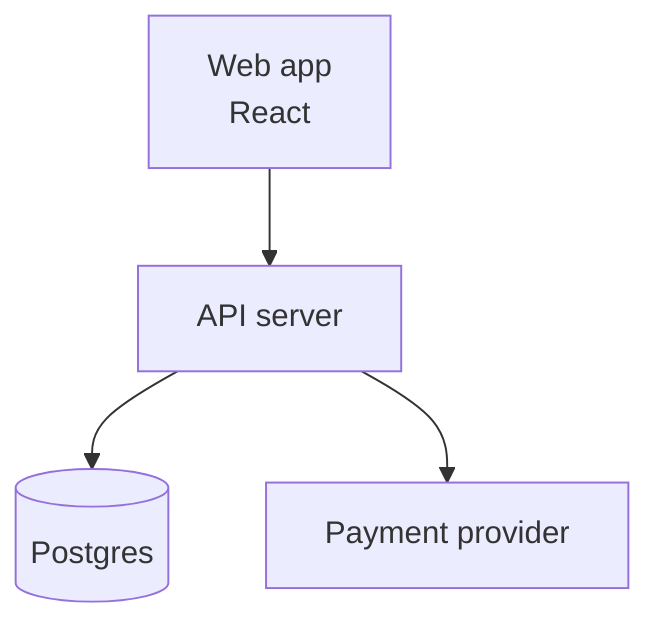
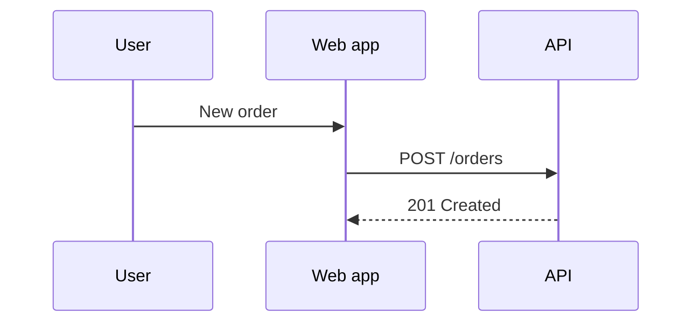

<!-- page id="start-welcome" group="Overview" title="Welcome" -->
# Acme documentation

Acme is a sample product used to show the page format. Replace these files with your own.

<a href="#guide-first-steps"><b>Product guides</b>Every feature, step by step.</a>
<a href="#api-orders"><b>API reference</b>Every endpoint.</a>

## How it fits together

> **Note** These docs describe the code on `main`. **Planned** marks decided work; **Known gap** marks code that differs.

<!-- page id="guide-first-steps" group="Getting started" title="First steps" -->
# First steps

Sign up and place a first order.

1. Open **Sign up** and enter your email.
2. Choose **New order**.

> **Planned** Saved carts, decided on 1 Jan 2027.

<!-- page id="api-orders" group="Orders" title="Orders" -->
# Orders

Create and read orders. See [First steps](#guide-first-steps).

### POST /orders

Creates an order. Auth: session cookie.

| Field | Type | Required | Notes |
|---|---|---|---|
| `items` | array | yes | At most 50 |

**Response** `201` with the order.

> **Known gap** No rate limit on this route (`src/orders.rs`).
