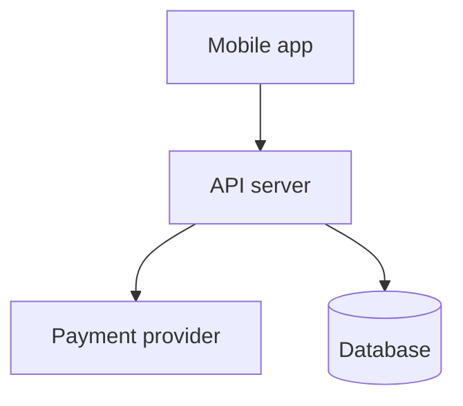

# Conventions template

Copy this into the project's docs workspace as `src/CONVENTIONS.md`. Fill every `{…}`. Delete lines that don't apply. Every writer reads this file first, so put product facts here that all of them need (owner, naming rules, decision sources), not in each brief.

---

# {Product} docs: writing conventions

These docs are a Stripe-style documentation site for {Product}, built into one HTML file by `build_docs.py`. Each writer owns one or more Markdown files in `src/docs/` and writes many pages in each.

## Who {Product} is

- {One paragraph: what the product is, its parts, who uses it.}
- {Owner / company naming rules, e.g. "The {Company} team operates everything. Leftover names of other companies in the code are **Known gaps**, not branding."}
- No secret values: no tokens, keys, passwords, private IP addresses or SSH addresses. Name secrets and environment variables, never their values.

## Sources of truth

- The code in {list repositories with absolute paths and one line each}. Use the checked-out default branch working tree. Do not read {worktrees, archives, build output}.
- Each repository's `docs/` and `README.md` help, but **the code wins** when they disagree. Trackers and plans can be stale: check the code before saying something is built.
- {Extra sources the user gave, each with path or link and what it is (PRD, decision log, flows, hosting notes)}: use them to mark things **Planned** (decided, not built) and **Known gap** (code differs from the decision). Where a source and the code disagree, describe what the code does and mark the difference.
- {If the user gave no extra sources, replace the line above with:} There are no sources outside the repositories. Use only the code and the files in the repositories. Mark **Planned** only for work the repositories themselves describe as planned (roadmap files, TODOs), citing where. Mark **Known gap** for code that is broken, inconsistent, unfinished or contradicts its own docs. Don't guess at intentions.
- Read only. Do not modify any repository, build, run tests, start services or contact servers. Write only your own Markdown files.

## File format

One file, many pages. Each page starts with a page marker line, then one `# Title`, then a one-paragraph lead:

```
<!-- page id="use-first-steps" group="Getting started" title="First steps" -->
# First steps

One or two sentences that say what this page covers and who it is for.

## First heading
...
```

- `id`: lowercase, hyphens, starts with your assigned prefix. Unique across the site.
- `group`: the sidebar group, listed in file order. Use 3 to 8 groups per file with short names. Don't reuse a group name another writer uses in the same tab; prefix it instead (for example "Server · Data").
- `title`: the sidebar label (may be shorter than the `#` heading).

## Writing style

- Plain, calm, exact. Short sentences. Explain a term on first use. User guides in plain words for {primary users}; architecture pages with real file paths, types and numbers for engineers.
- Use the real labels from the UI and the real messages from the code, with UI labels in **bold**.
- Cite code as `path/in/repo.ext` (repo-relative, in backticks). No large code blocks; short config or JSON examples are fine.
- Tables for reference material (settings, endpoints, fields, limits, states, permissions).
- Numbers from the code (timeouts, limits, ports, defaults), with where they come from.
- No marketing tone, no filler, no emoji.

## Callouts

A blockquote whose first word is bold:

```
> **Note** Something worth knowing.
> **Planned** Decided on {date} but not built yet: ...
> **Known gap** What the code does today that differs from the decision or is broken.
> **Warning** Something that can lose data, harm safety or break something.
```

Every Planned or Known gap is concrete (what, and where in the code). List each Known gap in your final report so it can go on the roadmap page.

## Links

- Link to another page with `[text](#page-id)`, using IDs from `PAGE_PLAN.md` or ones you create. The build reports any link that doesn't resolve.
- Headings get anchors automatically.

## Diagrams (Mermaid)

Use fenced `mermaid` blocks; never draw diagrams with text characters (no ASCII art, no box drawing).

````

````

- Types: `flowchart`, `sequenceDiagram`, `stateDiagram-v2`, `erDiagram`, `classDiagram`.
- Colour classes (defined by the builder): `own` for the product's own parts, `ext` for outside services, `data` for databases, files and storage, `bad` for error or blocked states, `hw` for physical hardware.
- Fit the page column (about 760 px): prefer `flowchart TB`, at most 4 to 5 boxes side by side, short labels with `<br>` for a second line. Sequence diagrams: at most 5 participants. Split a big diagram into two with a sentence between.
- Quote labels containing parentheses, colons, slashes or `#`: `a["Wi-Fi (setup)"]`. Don't use reserved words as node IDs (`end`, `call`, `class`, `style`, `graph`, `subgraph`, `click`, `default`).
- Every architecture page and every multi-step flow page has at least one diagram, used where it explains something.

## API endpoints

One level-3 heading per endpoint with the method and path only, then a description and tables:

```
### POST /api/v1/devices/register

What it does, who may call it, how it authenticates.

| Field | Type | Required | Notes |
|---|---|---|---|

**Response** `200` ...

**Errors** ...
```

The builder styles `### GET|POST|PUT|PATCH|DELETE|WS /path` headings as endpoint cards.

## Final report

Return: the page IDs and titles you wrote, the number of diagrams, any planned ID you dropped or added, every Known gap you found (one line each, with file path), and anything you could not confirm from the code.
